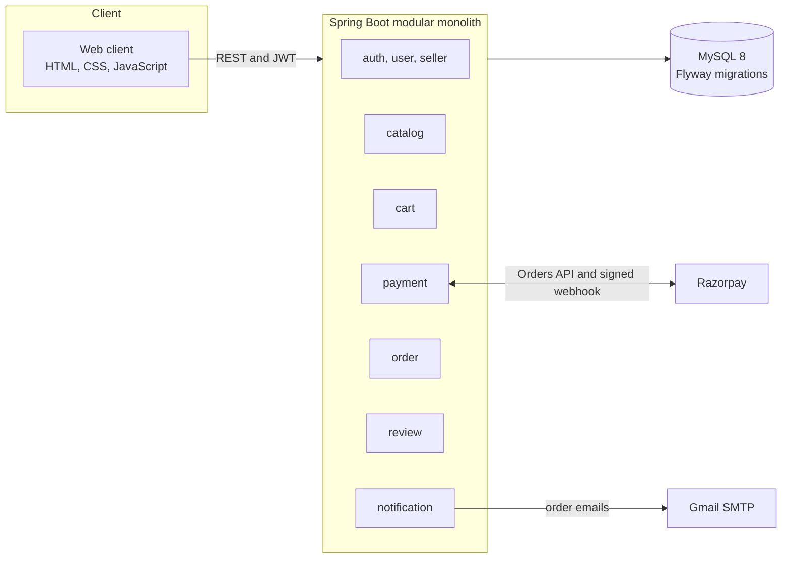
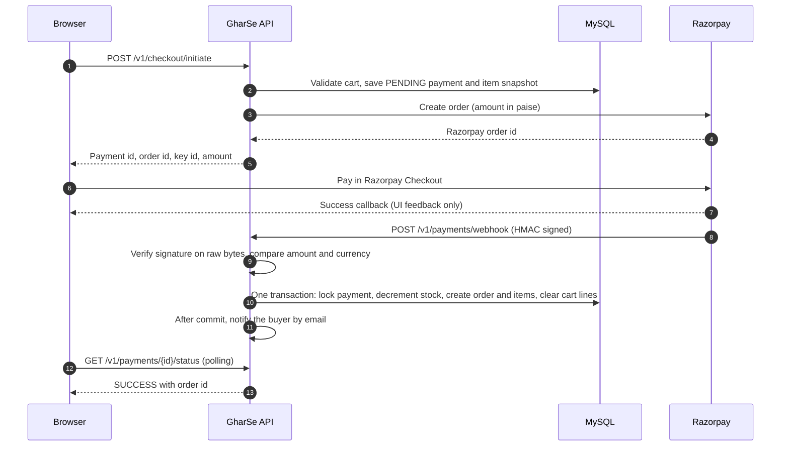
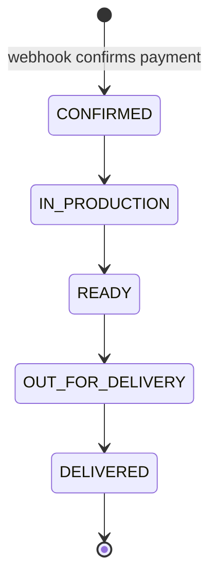
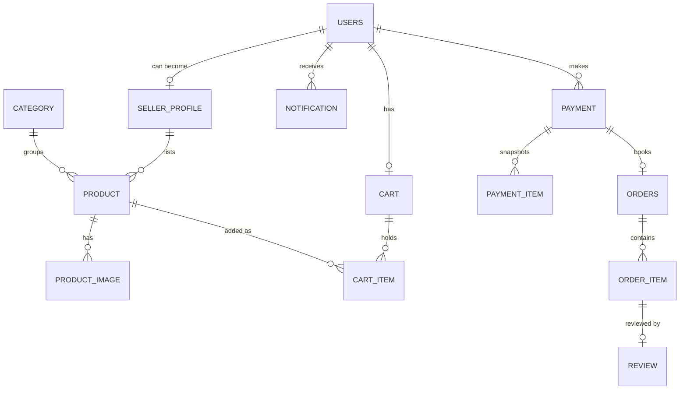

<div align="center">

# GharSe

**A location-based marketplace that connects Mumbai's women-led home businesses with customers nearby.**

Bakers, tailors, handicraft makers and self-help-group sellers get a ready-made digital storefront.
Buyers discover, pay for and track local, homemade products.


</div>

---

## Contents

- [Why GharSe exists](#why-gharse-exists)
- [Highlights](#highlights)
- [Architecture](#architecture)
- [Features](#features)
- [Quick start](#quick-start)
- [Configuration](#configuration)
- [Running the payment flow locally](#running-the-payment-flow-locally)
- [Testing](#testing)
- [API overview](#api-overview)
- [Engineering decisions](#engineering-decisions)
- [Project structure](#project-structure)
- [Known limitations and roadmap](#known-limitations-and-roadmap)
- [Troubleshooting](#troubleshooting)
- [Contributing](#contributing)
- [Team and context](#team-and-context)

---

## Why GharSe exists

Thousands of women in Mumbai run small food, tailoring and handicraft businesses from home. Most sell
through word of mouth because building and maintaining an online store is out of reach. A needs-assessment
survey of 49 respondents showed real interest in a low-friction online storefront.

GharSe gives those sellers one: list a product, set how it is fulfilled, and get paid. Buyers search by
distance, see an honest ready date for made-to-order items, pay securely, and follow the order to the door.
The project supports UN Sustainable Development Goals 8 (decent work and economic growth) and 5 (gender equality).

**Scope.** This repository set delivers **Phase 1: the product marketplace**. Service booking (appointments,
mehendi, tailoring slots) is deliberately deferred in full, and the code is modular so it can be added later
without a rewrite.

| Repository | What it contains |
|---|---|
| [GharSe-backend](https://github.com/Team-GharSe/GharSe-backend) | Spring Boot REST API, MySQL schema migrations, payments, notifications |
| [GharSe](https://github.com/Team-GharSe/GharSe.git) | Web client in plain HTML, CSS and JavaScript (no build step) |

---

## Highlights

- **Payments you can trust.** Razorpay payments are confirmed only by a signed server-to-server webhook.
  The browser callback is cosmetic. Booking is idempotent, amounts are verified, and the order is created
  in a single transaction.
- **No overselling under concurrency.** Ready-stock inventory uses JPA optimistic locking with a bounded
  retry, so two buyers racing for the last unit cannot corrupt the count.
- **One seller per cart.** The cart locks to a single seller and answers a conflicting add with a clear 409.
- **Honest delivery dates.** Made-to-order items show an estimated ready date computed live from the
  seller's real production queue, never from a stored counter that can drift.
- **Event-driven notifications.** Buyers are emailed when an order is booked and at every status change.
  Sending happens after the database commit, off the request thread, and can never fail an order.
- **Server-side authority.** Prices, totals, stock checks, order creation and role checks all run on the
  backend. Ownership checks return 404 for other people's resources, so IDs cannot be probed.
- **Strict order lifecycle.** Orders move forward only: Confirmed, In production, Ready, Out for delivery,
  Delivered. Skips, reversals and changes after delivery are rejected.
- **Schema under version control.** Flyway migrations, with applied migrations treated as immutable.

---

## Architecture

GharSe is a **modular monolith**: one deployable Spring Boot service with one package per module and a
single MySQL database. That fits the target scale (hundreds of sellers, low thousands of buyers) without the
operational cost of microservices.



### Checkout and payment

The part of the system with the highest risk gets its own flow. Only the signed webhook can create an order.



### Order lifecycle



<details>
<summary><b>Data model</b></summary>



One `users` table serves buyers and sellers: a user becomes a seller by gaining a seller profile, so nobody
picks a fixed role at sign-up. Schema changes live in `src/main/resources/db/migration` in the backend repository.

</details>

---

## Features

**For buyers**
- Browse and search by keyword, category and price range.
- Sort by distance from your location, or filter by radius.
- See live availability for ready stock and an estimated ready date for made-to-order items.
- Add to cart, check out with Razorpay, and follow the order from confirmation to delivery.
- Receive an email when the order is booked and at every status change.
- Review a product after the order is delivered.

**For sellers**
- Create a seller profile with a business name and location.
- List products as ready-stock or made-to-order, with up to three photos each, and choose fulfilment:
  self delivery, pickup or postal.
- See incoming orders and advance each one step at a time.
- Track the production backlog and sales analytics (revenue, units, orders per day).

**Web client pages:** marketplace, product, seller storefront, cart, checkout, buyer orders and order detail,
profile, sign-up and login, seller onboarding, dashboard, products and product form, incoming orders,
analytics and trends.

<!--
## Screenshots

| Marketplace | Product and ETA | Checkout |
|---|---|---|
|  |  |  |
-->

---

## Quick start

You need: **JDK 17 or newer**, **MySQL 8**, **Git**, and a browser. VS Code with the Live Server extension
(or any static file server on port 5500) serves the web client.

### 1. Create the database

```sql
CREATE DATABASE gharse CHARACTER SET utf8mb4;
CREATE USER 'gharse_app'@'localhost' IDENTIFIED BY 'choose-a-password';
GRANT ALL PRIVILEGES ON gharse.* TO 'gharse_app'@'localhost';
FLUSH PRIVILEGES;
```

### 2. Run the backend

```bash
git clone https://github.com/Team-GharSe/GharSe-backend.git
cd GharSe-backend

export DB_PASSWORD='choose-a-password'

./gradlew clean build -x test
java -jar build/libs/GharSe-backend-0.0.1-SNAPSHOT.jar
```

Flyway creates the schema on first start and seeds ten product categories. Check that it is up:

```bash
curl http://localhost:8080/v1/health
curl http://localhost:8080/v1/categories
```

Payments and email need a few more settings. See [Configuration](#configuration). Browsing, accounts, listings
and the cart work with `DB_PASSWORD` alone.

### 3. Run the web client

```bash
git clone https://github.com/Team-GharSe/GharSe-frontend.git
cd GharSe-frontend
```

Open the folder in VS Code and start **Live Server** on port **5500**, or run
`python3 -m http.server 5500`. Then open <http://127.0.0.1:5500>.

The backend allows cross-origin calls only from `http://127.0.0.1:5500` and `http://localhost:5500`, and the
client talks to `http://localhost:8080/v1` (see `js/config.js`).

### 4. Take it for a spin

1. Sign up two accounts. One will be the buyer, the other the seller.
2. Complete **seller onboarding** on the second account, then add a product.
3. As the buyer, find the product, add it to the cart and open checkout.
4. As the seller, open **Orders** and advance the order step by step.

No sample data ships with the project. Categories come from a migration, and everything else is created
through the app.

---

## Configuration

Secrets are read from environment variables. Nothing sensitive is committed.

| Variable | Needed for | Notes |
|---|---|---|
| `DB_PASSWORD` | Everything | Password of the `gharse_app` MySQL user (dev profile). |
| `RAZORPAY_KEY_ID`, `RAZORPAY_KEY_SECRET` | Checkout | Razorpay **test mode** API keys. Without them, `POST /v1/checkout/initiate` returns 502. |
| `RAZORPAY_WEBHOOK_SECRET` | Order booking | Must match the secret set on the Razorpay webhook. If empty, every webhook is rejected (fails closed). |
| `NOTIFICATIONS_EMAIL_ENABLED` | Real emails | Default `false`. When `false`, emails are written to the log instead of sent. |
| `GMAIL_USERNAME`, `GMAIL_APP_PASSWORD` | Real emails | Required when email is enabled. The app refuses to start without them. Use a 16-character Google app password. |

**Profiles.** The `dev` profile is active by default and connects to
`jdbc:mysql://localhost:3306/gharse` as `gharse_app`. The `prod` profile reads `DB_URL`, `DB_USER` and
`DB_PASSWORD`, and needs a strong JWT secret (`app.jwt.secret`) supplied from the environment. The secret in
`application-dev.yaml` is for local development only.

---

## Running the payment flow locally

Razorpay cannot reach `localhost`, so a tunnel is needed for the webhook that books orders.

1. Start the backend with the Razorpay variables set.
2. Open a tunnel: `ngrok http 8080`.
3. In the Razorpay Dashboard, in **Test Mode**:
    - Add a webhook pointing to `https://<your-ngrok-host>/v1/payments/webhook`.
    - Subscribe to `payment.captured` and `payment.failed`.
    - Set the secret to the value of `RAZORPAY_WEBHOOK_SECRET`.
    - Make sure payment capture is **automatic**.
4. Check out in the web client and pay with a Razorpay test card from the Razorpay documentation.

The checkout page waits for the order to be booked, then opens it. If the webhook cannot reach the server,
the payment succeeds at Razorpay but no order is created. That is by design: only the signed webhook may
book an order.

**Email notifications (optional).** Set `NOTIFICATIONS_EMAIL_ENABLED=true`, `GMAIL_USERNAME` and
`GMAIL_APP_PASSWORD`, then restart. Buyers receive an email from "GharSe" when an order is booked and at each
status change. SMS is simulated (logged only) because real SMS in India requires DLT registration.

---

## Testing

```bash
./gradlew test
```

Tests use JUnit 5 and Mockito. They cover the parts that are easy to get wrong:

- Webhook signature verification, amount checks and idempotent booking.
- The optimistic-lock retry when two payments race for the last unit.
- The single-seller cart rule and server-side totals.
- The order status state machine, including every illegal transition.
- Notification channel choice, failure recording and message text.
- The estimated-ready-date calculation, and that the product page and cart agree.

A few tests run against MySQL, so keep your local instance running.

---

## API overview

All endpoints are versioned under `/v1`. Authentication is a JWT in the `Authorization: Bearer <token>`
header. Roles (`BUYER`, `SELLER`, `ADMIN`) are derived on the server at login: a user is a `SELLER` once a
seller profile exists.

Every response uses one envelope:

```json
{ "success": true, "status": 200, "data": { }, "timestamp": "2026-11-01T11:41:22Z" }
```

```json
{
  "success": false,
  "status": 409,
  "error": "CONFLICT",
  "message": "Your cart already has items from Lata's Chakli Ghar. Clear your cart before adding items from another seller.",
  "timestamp": "2026-11-01T11:44:03Z"
}
```

<details>
<summary><b>Endpoint reference</b></summary>

| Method | Endpoint | Access | Purpose |
|---|---|---|---|
| POST | `/v1/auth/register` | Public | Create an account (name, phone, optional email, password) |
| POST | `/v1/auth/login` | Public | Log in with phone or email, returns a JWT and role |
| GET, PUT | `/v1/users/me` | JWT | View or update your profile |
| POST | `/v1/seller/profile` | JWT | Become a seller |
| GET | `/v1/seller/me` | Seller | Your seller profile |
| GET | `/v1/seller/{sellerProfileId}` | Public | A seller's public profile |
| GET | `/v1/categories` | Public | Product categories |
| GET | `/v1/products/search` | Public | Search with `q`, `category_id`, `min_price`, `max_price`, `lat`, `lng`, `radius_km`, `sort`, `page`, `page_size` |
| GET | `/v1/products/{id}` | Public | Product detail |
| GET | `/v1/products/{id}/eta` | Public | Ready-stock availability, or ready date for made-to-order (`?quantity=`) |
| GET | `/v1/products/{id}/reviews` | Public | Reviews for a product |
| POST | `/v1/products` | Seller | Create a listing |
| PUT, DELETE | `/v1/products/{id}` | Seller | Edit or remove (soft delete) a listing |
| POST | `/v1/products/{id}/photos` | Seller | Upload up to three photos |
| DELETE | `/v1/products/{id}/photos/{imageId}` | Seller | Remove a photo |
| GET | `/v1/seller/me/products` | Seller | Your listings |
| GET | `/v1/cart` | JWT | View the cart with server-side totals |
| POST | `/v1/cart/items` | JWT | Add an item (409 if it belongs to another seller) |
| PUT, DELETE | `/v1/cart/items/{productId}` | JWT | Change quantity or remove an item |
| DELETE | `/v1/cart` | JWT | Clear the cart and release the seller lock |
| POST | `/v1/checkout/initiate` | JWT | Snapshot the cart and create the Razorpay order |
| GET | `/v1/payments/{paymentId}/status` | JWT (owner) | Poll payment status and order id |
| POST | `/v1/payments/webhook` | Razorpay signature | Book the order (no JWT, separate trust boundary) |
| GET | `/v1/orders/me` | JWT | Your orders |
| GET | `/v1/orders/{orderId}` | Buyer or owning seller | Order detail |
| GET | `/v1/seller/me/orders` | Seller | Incoming orders, optional `?status=` |
| PATCH | `/v1/orders/{orderId}/status` | Seller | Advance an order one step |
| POST | `/v1/order-items/{orderItemId}/review` | Buyer | Review a delivered item |
| GET | `/v1/seller/me/backlog` | Seller | Committed units per made-to-order listing and the queue clear date |
| GET | `/v1/seller/me/analytics` | Seller | Revenue, units and orders per day (`from`, `to` as `yyyy-MM-dd`, default last 30 days, max 366) |
| GET | `/v1/notifications/me` | JWT | Your latest 50 notifications |
| GET | `/v1/health` | Public | Liveness check |

Checkout and payment responses use `snake_case` keys. For example, `POST /v1/checkout/initiate` returns:

```json
{ "payment_id": 12, "razorpay_order_id": "order_...", "razorpay_key_id": "rzp_test_...", "amount": 25000, "currency": "INR" }
```

`amount` is in paise, as Razorpay expects.

</details>

---

## Engineering decisions

| Problem | Decision | Why |
|---|---|---|
| A forged "payment succeeded" request | Only the signed Razorpay webhook creates an order. The browser callback is UI feedback, and the client polls a status endpoint. | The browser can never be trusted with money. |
| A fake webhook | HMAC-SHA256 over the raw request bytes, compared in constant time. With no secret configured, everything is rejected. | Re-serialised JSON would not match the signature, and the endpoint fails closed. |
| Duplicate webhook deliveries | Row lock on the payment, plus unique `razorpay_order_id` and `orders.payment_id`. | Razorpay retries, so booking is exactly-once. |
| Wrong amounts | Money is `BigDecimal`, converted to paise exactly. The webhook's amount and currency are compared with the stored snapshot before booking. | No rounding drift, and a tampered amount never books. |
| Prices changing after checkout | Immutable checkout snapshot, then order-item snapshots of name and price. | History never rewrites itself when a seller edits a listing. |
| Slow gateway holding database locks | The Razorpay HTTP call runs outside any database transaction. | A slow third party must not stall the database. |
| Overselling the last unit | JPA `@Version` optimistic locking, with the whole booking transaction retried a bounded number of times. If stock is truly gone after a reload, the order is still booked and stock is clamped at zero. | Accurate counts under concurrency, and a paid buyer is never left without an order. There is no refund flow in Phase 1. |
| Mixed-seller carts | Cart is row-locked and tied to one seller, and a conflicting add returns 409 naming the seller. | Keeps payment to order one-to-one and avoids split checkout. |
| Notifications breaking orders | Domain events handled after commit on a dedicated single-thread executor. Failures are recorded as `FAILED`, never thrown. | An email outage cannot undo an order, and notifications go out in order. |
| Stale delivery estimates | Ready date computed live from the seller's open orders, weighted by production minutes. | A stored counter drifts the first time someone forgets to decrement it. |
| Probing other users' data | Server-side role and ownership checks. A foreign resource returns the same 404 as a missing one. | IDs cannot be enumerated. |
| Schema drift | Flyway migrations, never edited once applied. | Every environment reaches the same schema. |

---

## Project structure

<details>
<summary><b>Backend (<code>GharSe-backend</code>)</b></summary>

```text
src/main/java/com/gharse/
├── auth/          registration, login, JWT
├── user/          user accounts
├── seller/        seller profiles
├── catalog/       products, photos, search, estimated ready date
├── cart/          cart with single-seller lock
├── payment/       checkout, Razorpay client, webhook, status
├── order/         orders, status state machine, seller analytics
├── review/        purchase-verified reviews
├── notification/  order events, email and SMS senders
├── common/        response envelope and shared exceptions
├── config/        security, CORS, JWT filter
├── health/        liveness endpoint
└── admin, support, verification/   reserved for later phases
src/main/resources/db/migration/    Flyway migrations
scripts/                            curl smoke-test scripts
```

</details>

<details>
<summary><b>Web client (<code>GharSe-frontend</code>)</b></summary>

```text
index.html
pages/    account, auth, buyer, marketplace, seller
js/
├── config.js, api.js, auth.js, nav.js, toast.js, geo.js
├── core/       shared helpers
├── services/   one wrapper per API area
└── pages/      one script per page, grouped by area
css/
```

Plain HTML, CSS and JavaScript loaded as classic scripts, with no framework and no build step. The browser
holds no business logic: prices, totals, stock and order creation come from the server, and the only thing
stored locally is the JWT.

</details>

---

## Known limitations and roadmap

Stated plainly, so nobody has to find them the hard way.

**Not in Phase 1**
- **Admin moderation, seller verification (the lab-test badge) and support tickets.** The ranking boost for
  verified listings is implemented, but no listing can earn the badge yet.
- **Service booking** (appointments and slots).
- **Real SMS.** Messages are simulated and only logged. Email is real when enabled.
- **Refunds.** The double-sale edge case books the order and clamps stock instead of refunding.

**Technical debt**
- Not hosted: the project runs locally. A `prod` profile exists but has not been deployed.
- The role is carried in the 24-hour JWT, so a role change such as becoming a seller applies after the next login.
- JSON naming is mixed: checkout and payment responses use `snake_case`, the rest use `camelCase`.
- Product photos are stored on local disk, not in object storage.
- Notification events are in memory. A crash between commit and send loses that one email.
- The dev database URL pins `serverTimezone=Asia/Kolkata`. See [Troubleshooting](#troubleshooting).
- No CI pipeline and no OpenAPI specification yet.

**Next steps**
1. GitHub Actions to build and test every pull request.
2. An OpenAPI specification and Swagger UI.
3. Admin moderation and the verification workflow.
4. A refund flow, and a durable outbox for notifications.
5. Cloud object storage for photos, and Marathi localization.

---

## Troubleshooting

<details>
<summary><b>The app will not start</b></summary>

- **`Migrations have failed validation`.** A migration was renamed or edited after being applied to your local
  database. Locally, drop and recreate the database and start again. Never edit an applied migration.
- **`Email is enabled but ... is not set`.** `NOTIFICATIONS_EMAIL_ENABLED=true` needs both `GMAIL_USERNAME`
  and `GMAIL_APP_PASSWORD`. Unset the switch to run without real email.
- **`./gradlew bootRun` stalls.** Build the jar and run it with `java -jar`, as in the quick start.
- **Port 8080 is busy.** Stop the other process, or run on another port.

</details>

<details>
<summary><b>Behaviour looks wrong</b></summary>

- **Browser calls fail with a CORS error.** Serve the client on port 5500 and open it as `127.0.0.1:5500` or
  `localhost:5500`.
- **Payment succeeds but the order never appears.** The webhook is not reaching the server. Check that the
  tunnel is running, the dashboard URL matches the current tunnel address, and the webhook secret matches.
- **`updatedAt` appears earlier than `createdAt`.** Your MySQL server's time zone differs from the
  `serverTimezone` in the dev URL. Either set the server to match (`SET GLOBAL time_zone = '+05:30';`), or
  override the URL with `SPRING_DATASOURCE_URL` using `serverTimezone=UTC` and a UTC server.
- **Gmail rejects the login.** Create a fresh 16-character app password with no spaces. Changing the Google
  account password revokes existing app passwords.

</details>

---

## Contributing

- Work on a feature branch (`feature/<module>`) and open a pull request into `main`. No direct pushes.
- Never edit a Flyway migration once applied. Agree a new version number with the team before adding one.
- Return every response through the shared `ApiResponse`, and raise the shared exceptions for errors.
- Resolve the caller from the JWT principal and check ownership on the server. Never trust ids or roles
  sent by the client.
- Keep changes to `SecurityConfig` and `GlobalExceptionHandler` small, since they cause merge conflicts.
- Never commit secrets. `.env` and `application-local.yaml` are git-ignored.
- Check endpoints with curl scripts like `scripts/auth-smoke.sh` in the backend repository.

More backend conventions are in `README_SETUP.MD` in the backend repository.

---

## Team and context

Built by **Team GharSe** as the Community Engagement Project (course 25ITIL3CEP01) for the B.E. Information
Technology program at **Don Bosco Institute of Technology, Mumbai**. See each repository's contributors page
for the people behind it.

<!--
| Name | Focus |
|---|---|
| Your Name | Backend: ... |
-->

Documents prepared alongside the code: the Problem Statement and Needs Assessment Report, the Project
Synopsis, and the IT Solution Overview (requirements, schema, API, architecture and risk analysis).

License: see the `LICENSE` file in the backend repository.